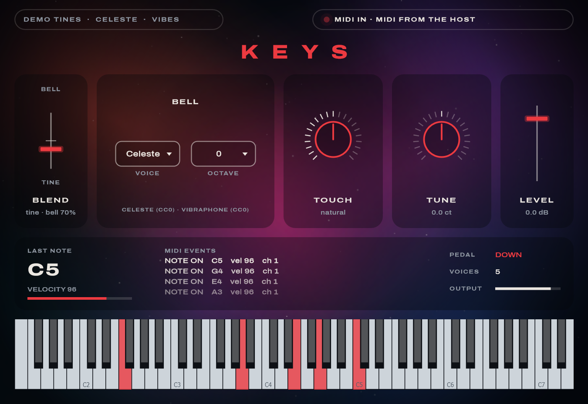

# Rainy Night Keys

A nostalgic electric piano: the tines of a Rhodes Mark II blended with a celeste or a vibraphone,
plus knobs that add colour and fullness. A Standalone app and a VST3, built with C++20 and JUCE 8.
The plugin is called **Keys** in the current build.



**Status: milestone M1, a playable demo.**
- The tines are a physical model rendered into samples, standing in until a real Mk II is sampled.
- The bell layer uses real public-domain (CC0) celeste and vibraphone recordings.
- Working now: MIDI, the sustain pedal, Blend, the bell options, Touch, Tune and Level.
- Not built yet: the colour knobs and the moving light from the
  [Nocturne demo](docs/mockup/nocturne.html). See
  [what's built and what isn't](docs/user-guide.md#the-app-compared-with-the-nocturne-demo).

## Docs

- [User guide](docs/user-guide.md): the window, testing your MIDI keyboard, troubleshooting
- [Sampling plan](docs/sampling-plan.md): the short checklist for the Mk II recording day
- [Sampling guide](docs/sampling-guide.md): the full version, with the reasons
- [UI design](docs/ui-design.md), plus HTML mockups in [docs/mockup](docs/mockup)
  (`nocturne.html` is the current direction)

## Build and run (Windows)

Requirements: Visual Studio 2026 (C++ workload), CMake ≥ 3.25, and JUCE 8.0.12 checked out at `../JUCE`
(otherwise it's downloaded automatically).

```powershell
powershell -ExecutionPolicy Bypass -File scripts\fetch-bell-samples.ps1   # once: CC0 celeste + vibes (46 MB)
cmake --preset vs2026
cmake --build --preset release
ctest --preset release
build\vs2026\Keys_artefacts\Release\Standalone\Keys.exe
```

The bell samples aren't in git (they're large, and the script fetches them). Without them, Keys
plays a modeled bell instead.

## Development

| Task | Command |
|---|---|
| Unit tests | `ctest --preset release`, or `build\vs2026\Release\KeysTests.exe "[tag]"` |
| Validate the VST3 | `powershell -ExecutionPolicy Bypass -File scripts\run-pluginval.ps1` |
| Screenshot the window | `build\vs2026\KeysUiSnapshot_artefacts\Release\KeysUiSnapshot.exe ui.png --demo [--scale 1.5] [--set blend=0.8]` |
| Use the VST3 in Live | `scripts\install-dev-link.ps1` from an elevated PowerShell, then rescan plug-ins |

```
source/engine   sampler, voices, tine model, sample banks (no GUI; unit-tested)
source/ui       look and feel, backdrop
source          processor, editor, parameters
tests           Catch2 tests and the screenshot tool
docs            guides, design, mockups, screenshots
assets          fonts (OFL), bell samples (fetched), credits
```

Credits for samples and fonts: [assets/CREDITS.md](assets/CREDITS.md). JUCE is dual-licensed
(AGPLv3 or commercial): check its terms before distributing binaries.
