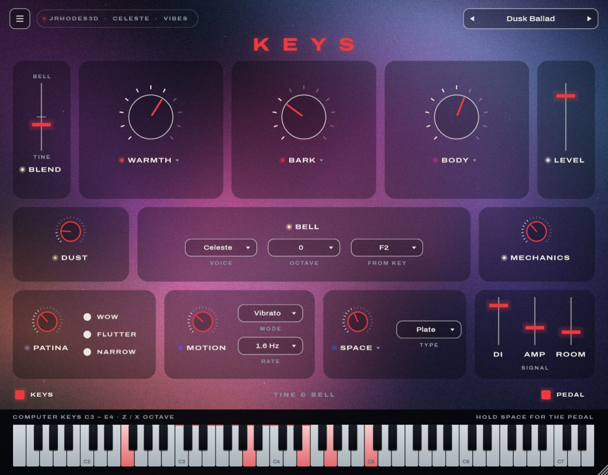
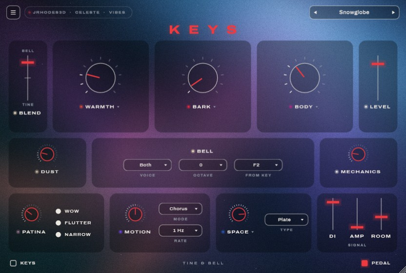
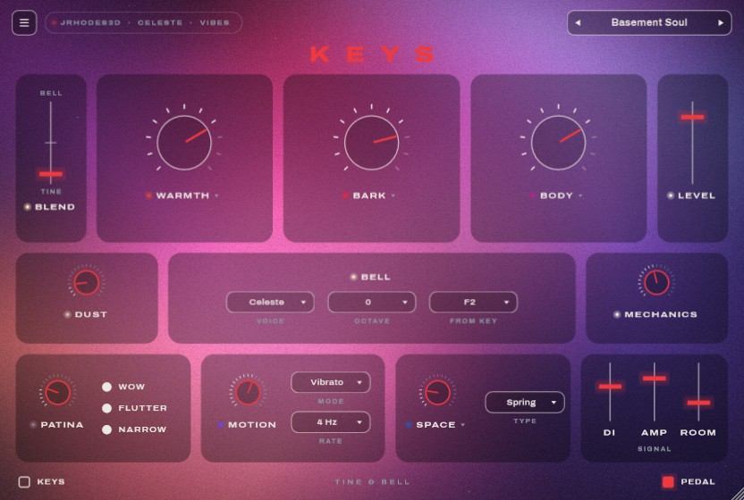
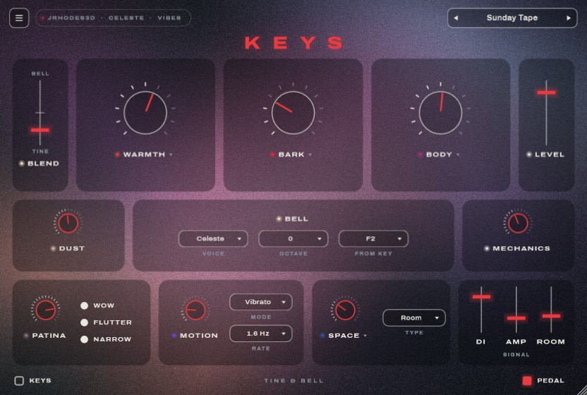
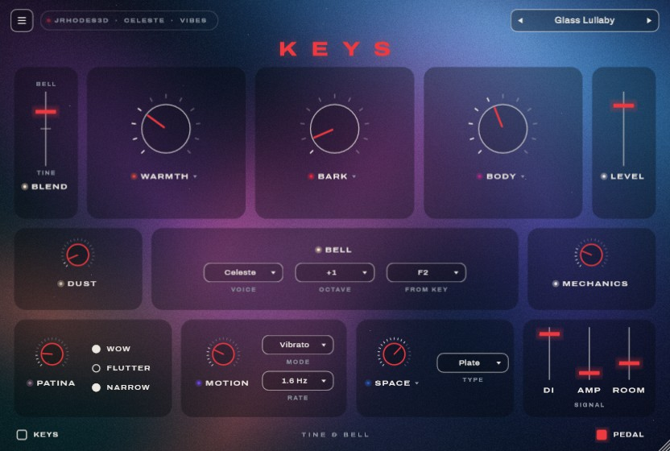
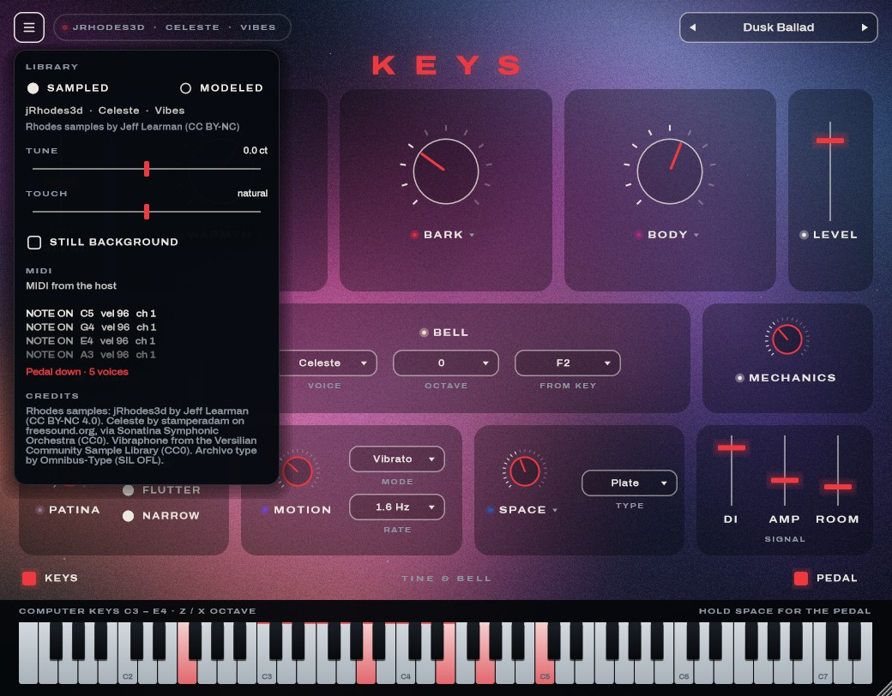
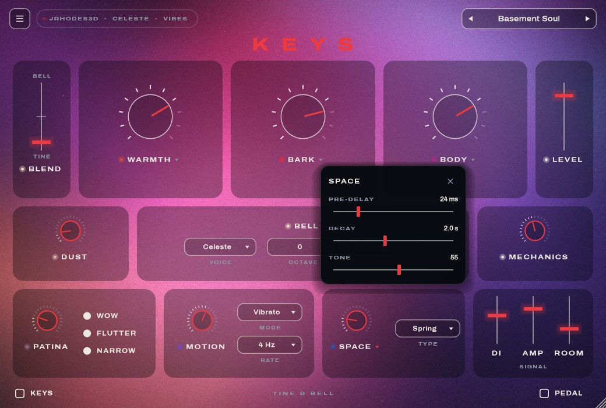

# Rainy Night Keys

A nostalgic electric piano: the tines of a Rhodes Mark II blended with a celeste or a vibraphone,
plus knobs that add colour and fullness. A Standalone app and a VST3, built with C++20 and JUCE 8.
The plugin is called **Keys** in the current build.



**Status: the Nocturne window, fully working, with sampled Rhodes tines.**
- The tines are a real Rhodes, sampled: [jRhodes3d](https://github.com/sfzinstruments/jlearman.jRhodes3d)
  (a 1977 Mark I, CC BY-NC), standing in until the Mk II is recorded. A physical model of the
  tines is built in too, so Keys plays even without the samples, and the menu switches between them.
- The bell layer uses real public-domain (CC0) celeste and vibraphone recordings.
- Working: MIDI, the sustain pedal, Blend and the bell options; the colour knobs Warmth, Bark,
  Body, Patina, Motion, Space, Dust and Mechanics with their fine controls; the DI / Amp / Room
  mixer; seven factory presets plus your own; the moving light behind the controls; the
  computer keyboard. See the [user guide](docs/user-guide.md).
- Your own recordings load the same way as the Rhodes demo set: an SFZ map in
  `assets/tines/<name>/` (see the [sampling guide](docs/sampling-guide.md#11-what-happens-next-the-prep-tool)).

## A look around

The light behind the controls takes its colour from the sound: every preset looks different.

| | |
|---|---|
|  |  |
| **Snowglobe**: mostly bell, chorus, a big plate | **Basement Soul**: barking, through the amp, spring reverb |
|  |  |
| **Sunday Tape**: worn cassette, room reverb | **Glass Lullaby**: bell-forward, an octave up |
|  |  |
| **☰ Menu**: sampled or modeled tines, Tune, Touch, a MIDI monitor | **▾ Fine controls**, here Space's pre-delay, decay and tone |

## Docs

- [User guide](docs/user-guide.md): the window, every control, presets, testing your MIDI keyboard
- [Sampling plan](docs/sampling-plan.md): the short checklist for the Mk II recording day
- [Sampling guide](docs/sampling-guide.md): the full version, with the reasons
- [UI design](docs/ui-design.md), plus HTML mockups in [docs/mockup](docs/mockup)
  (`nocturne.html` is what the window is built from)

## Build and run (Windows)

Requirements: Visual Studio 2026 (C++ workload), CMake ≥ 3.25, and JUCE 8.0.12 checked out at `../JUCE`
(otherwise it's downloaded automatically).

```powershell
powershell -ExecutionPolicy Bypass -File scripts\fetch-rhodes-samples.ps1 # once: Rhodes tines (22 MB, CC BY-NC)
powershell -ExecutionPolicy Bypass -File scripts\fetch-bell-samples.ps1   # once: CC0 celeste + vibes (46 MB)
cmake --preset vs2026
cmake --build --preset release
ctest --preset release
build\vs2026\Keys_artefacts\Release\Standalone\Keys.exe
```

The samples aren't in git (they're large, and the scripts fetch them). Without them, Keys plays
its modeled tines and a modeled bell instead.

## Development

| Task | Command |
|---|---|
| Unit tests | `ctest --preset release`, or `build\vs2026\Release\KeysTests.exe "[tag]"` |
| Validate the VST3 | `powershell -ExecutionPolicy Bypass -File scripts\run-pluginval.ps1` |
| Screenshot the window | `build\vs2026\KeysUiSnapshot_artefacts\Release\KeysUiSnapshot.exe ui.png --demo --keys [--menu] [--fine space] [--preset 3] [--annotate] [--scale 1.5] [--set blend=0.8]` (write `.jpg` for the docs) |
| Time the UI | the same tool with `--bench` |
| Hear every preset | `build\vs2026\KeysRender_artefacts\Release\KeysRender.exe build\renders [--tines modeled] [--set dust=0]`: a phrase through each preset as WAVs, with their levels |
| Time the engine | `build\vs2026\Release\KeysTests.exe "[.bench]"` |
| Use the VST3 in Live | `scripts\install-dev-link.ps1` from an elevated PowerShell, then rescan plug-ins |

```
source/engine   sampler, voices, tine model, sample banks and SFZ maps, colour chain, reverb (no GUI; unit-tested)
source/ui       look and feel, the moving light, tiles and controls, popovers, keyboard
source          processor, editor, parameters, presets
tests           Catch2 tests, the screenshot tool and the render tool
docs            guides, design, mockups, screenshots
assets          fonts (OFL), bell samples (fetched), credits
```

Credits for samples and fonts: [assets/CREDITS.md](assets/CREDITS.md). JUCE is dual-licensed
(AGPLv3 or commercial): check its terms before distributing binaries.
