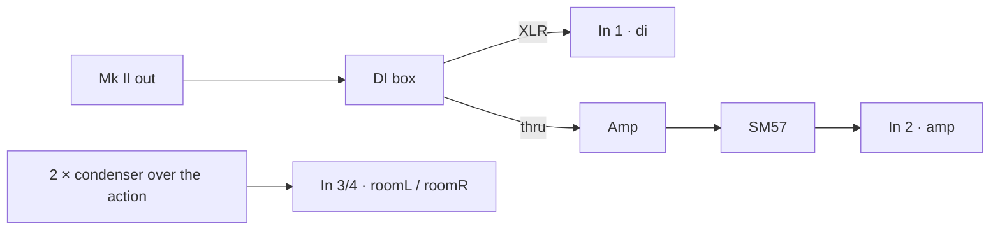

# Sampling plan — the short version

A plan to follow from booking the piano to handing over the files. The reasons behind each step are
in the full [sampling guide](sampling-guide.md).

**Target:** all 73 keys of the Mk II, about 20 strikes each from whisper to bark, plus release,
key-noise and pedal recordings. That's one long day, or two half-days. The run sheet records every
third key first, so a complete, playable library exists after the first ~2 hours even if the day
ends early.



## 3–4 weeks before

- [ ] Book the piano and a quiet room for a full day (or two half-days).
- [ ] If the piano isn't yours: get the owner's OK in writing (an email is enough).
- [ ] Rhodes tech service: tuning, **voicing** (the balance of bark and bell, decided by ear and
      baked into every sample), hammer tips, damper felts, regulation. Photograph the settings.
- [ ] Ask the tech for a couple of spare tines: the loudest strikes are hard.
- [ ] Decide the amp: **A** in another room (record all 4 channels at once), or **B** re-amp the DI
      files afterwards (record only DI + room on the day). Choose B if the amp can't be isolated.
- [ ] Gather the gear:
  - [ ] Audio interface with 4 inputs, at 48 kHz / 24-bit.
  - [ ] Active DI with a thru output.
  - [ ] Clean amp, and an SM57-type mic for it.
  - [ ] 2 small-diaphragm condensers.
  - [ ] Stands and cables, plus spares.
  - [ ] Closed headphones.
  - [ ] A tuner.
  - [ ] 2 external drives.
  - [ ] A thermometer.

## The week before

- [ ] Test the whole chain at home. Record 60 s of silence and listen loudly for hum, buzz and fans.
- [ ] Set up a Live template:
  - [ ] 48 kHz / 24-bit.
  - [ ] Four mono audio tracks named `di`, `amp`, `roomL`, `roomR`.
  - [ ] No plugins, and monitoring off.
- [ ] Print this plan, a key list (E1 … E7) and the session log
      ([template](templates/session-log.csv)).

## The day before

- [ ] Move the piano into the recording room, at least 24 h ahead, so it settles to the room
      temperature.

## Session day — run sheet

| Time | Step | Notes |
|---|---|---|
| 0:00 | **Set up** the piano, DI split, amp, mics | Piano **Volume at max**. Set Bass Boost to a fixed position and write it down. Room mics about 40 cm above the hammers. |
| 1:00 | **Set levels** | The hardest strike on the lowest key peaks at −6 dBFS on every input. Tape the gain knobs and never touch them again. |
| 1:15 | **Silence check** | 60 s of silence, listened to loudly. Fix any hum now. |
| 1:30 | **Room tone** | 30 s, nobody moving. |
| 1:35 | **Pass A**: every third key, E1, G1, A♯1 … E7 (25 keys) | Crescendo takes (routine below). At the end of this pass, a playable library exists. |
| ~3:30 | Break + **backup to both drives** | |
| 3:45 | **Pass B**: the other 48 keys, octave by octave | Same routine. |
| ~7:00 | **Release pass**, all keys | 3 strikes per key (below). |
| ~7:30 | **Key noise and pedal pass** | Below. |
| ~7:50 | **Room tone** again, then back up and pack up | |

**Every hour:**
- [ ] Check the tuning on A2, A4 and A6, and write the room temperature in the log.
- [ ] Play back the last few keys.

### The crescendo take (one per key)

1. Note the key in the log (one log row per recording segment).
2. Play about **20 strikes**, from the softest that still sounds up to a full bark, evenly spread.
3. Hold the key and let each strike **ring until it dies**, up to:

   | Keys | Ring up to |
   |---|---|
   | E1–B2 | 18 s |
   | C3–D♯5 | 9 s |
   | E5–E7 | 4 s |

4. If a strike goes wrong (a buzz, a double hit), play one extra and write it down.

You don't need exact dynamics or MIDI. The prep tool measures every strike and builds the velocity
layers from that.

### The release pass (per key)

Three strikes: soft, medium, hard. Hold for 1.5 s (0.8 s from E5 up), release cleanly, then wait
about 1 s for the damper and ring-out.

### Key noise and pedal

- On 12 keys spread over the keyboard: press each key 3 times, so slowly that the hammer doesn't
  sound the tine. Then release it.
- The sustain pedal: 10 times down and 10 times up, slow, normal and stomped, with no notes sounding.

## Afterwards

1. In Live, export each segment with **Export All Individual Tracks**: WAV, 48 kHz / 24-bit, no
   normalize, no dither.
2. Name the files `<pass>_<segment>_<source>.wav`, e.g. `cresc_E1-D#2_di.wav`, `release_C3-B3_roomL.wav`.
3. Hand over one folder:

```
session-YYYY-MM-DD/
  raw/            all exported WAVs
  roomtone/       roomtone_start_di.wav, roomtone_end_roomL.wav, ...
  session-log.csv
  photos/         voicing, mic positions, gain knobs
  notes.txt       piano model, year and serial, the tech's notes, anything unusual
```

## Quick reference

| What | Value |
|---|---|
| Format | 48 kHz / 24-bit mono WAV per input |
| Level | hardest bass strike at −6 dBFS, gain never touched again |
| Strikes per key | about 20, whisper to bark |
| Ring time | 18 s bass · 9 s mid · 4 s top |
| Releases | 3 per key, held 1.5 s (0.8 s top) |
| Tuning check | hourly, A2 / A4 / A6, plus the temperature |
| Backups | both drives, at every break |
| Size | about 9 GB of raw WAV for the full day |
