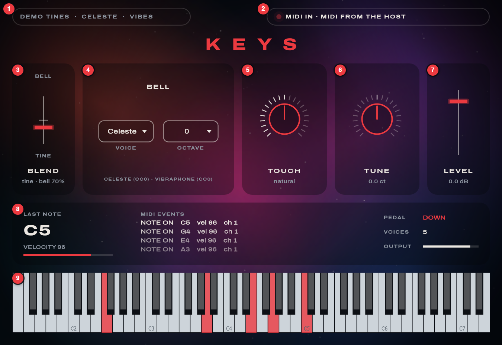
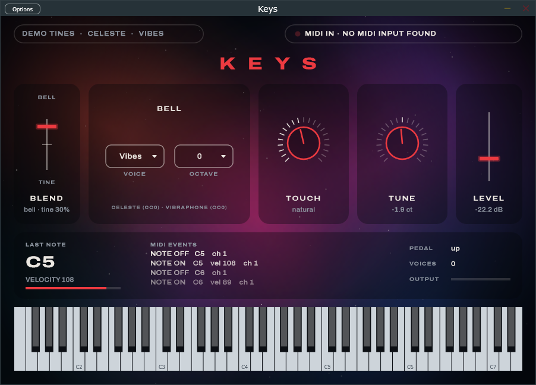
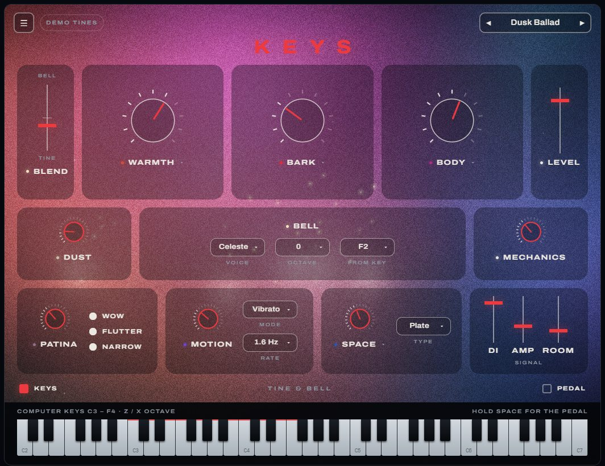

# Keys — user guide (M1 demo)

What the current build does, how to test your MIDI keyboard with it, and how it differs from the
Nocturne design demo. All screenshots are of the real app unless the caption says otherwise.

## Start it

Run `build\vs2026\Keys_artefacts\Release\Standalone\Keys.exe` (build steps are in the
[README](../README.md)). The library chip **(1)** says `LOADING TINES...` for about a second, then
`DEMO TINES · CELESTE · VIBES`. Notes are silent until then.

## The window

| # | Part | What it does |
|---|---|---|
| 1 | Library chip | Which sounds are loaded. *Modeled bell* instead of *Celeste* means the bell samples are missing: run `scripts\fetch-bell-samples.ps1`. |
| 2 | MIDI chip | The MIDI inputs the app found. The red light flashes on every MIDI message. |
| 3 | Blend | Tines at the bottom, bell at the top, both at full in the middle (it snaps there). |
| 4 | Bell | **Voice**: Celeste, Vibes, or Both (vibes below C4, celeste above). **Octave**: 0 or +1. |
| 5 | Touch | Velocity response: *even* (soft playing still sounds full) to *dynamic*. |
| 6 | Tune | ±50 cents. |
| 7 | Level | Output level, −∞ to +6 dB. |
| 8 | Monitor | Last note and velocity, the latest MIDI events, the pedal, voices playing, output level. |
| 9 | Keyboard | 73 keys, E1–E7, like a Mk II. Lights up for incoming MIDI. Click to play: lower on a key is louder. |

Every knob and slider: drag to change it, double-click to reset.

## Test your MIDI keyboard

1. Plug the keyboard in (before or while the app runs). Within about 2 seconds it's listed in the
   MIDI chip **(2)**: the app switches on every input it finds.
2. Play a few notes. The light in **(2)** flashes, the monitor **(8)** shows `NOTE ON C4 vel 96 ch 1`
   and so on, and the key lights up on **(9)**.
3. Press the sustain pedal. The monitor shows `CC 64 (sustain) 127` and `PEDAL DOWN`. Notes ring on
   after you let go of the keys until you lift the pedal.
4. Play soft and hard. Velocity should move across the whole bar in **(8)**. If your hardest
   playing never gets near the end, or soft notes vanish, move **Touch (5)**.

**Something not working?**

- **The chip says `No MIDI input found`**: Windows doesn't report any MIDI device. Re-plug the
  keyboard, try another USB port or cable, and check it appears in Device Manager.
- **The keyboard is listed but nothing arrives**: another program may be holding it. On Windows a
  MIDI input is usually open in one program at a time, so close Ableton Live (or its MIDI
  preferences) and try again. You can also tick the input by hand: **Options** (top left of the
  window) → *Audio/MIDI Settings* → *Active MIDI inputs*.
- **No sound**: Options → *Audio/MIDI Settings* → pick your output device. Check that Level **(7)**
  isn't at −∞.
- **Clicks or crackles, or a late response**: in the same dialog choose an ASIO or WASAPI device,
  with a buffer of 128–256 samples.

## The app compared with the Nocturne demo

The [Nocturne demo](mockup/nocturne.html) is the design target. The app is milestone M1: the
sound engine, MIDI and a basic window. The demo has more than the app does today.

*The Nocturne HTML demo. This is a design preview, not a screenshot of the app.*

| Feature | Nocturne demo | App today | Coming in |
|---|---|---|---|
| Sound | small browser synth standing in | **real engine**: modeled Mk II tines plus celeste and vibraphone samples | — |
| Blend, Bell voice and octave, Level | yes | yes | — |
| Bell "from key" | dropdown | fixed at F2 | M2 |
| Touch, Tune | in the ☰ menu | on the main window | M3 (move) |
| Warmth, Bark, Body (with ▾ fine controls) | yes | **not yet** | M2 |
| Patina (Wow, Flutter, Narrow), Motion (Mode, Rate), Space (Type) | yes | **not yet** | M2 |
| Dust, Mechanics | yes | **not yet** | M2 |
| DI / Amp / Room mix | yes | **not yet** (needs Amp and Room sources) | M2 |
| Presets | yes | **not yet** | M2 |
| Moving light behind the controls, tinted by the knobs, with glows and sparkles on notes | yes | **not yet**: a still background picture | M3 |
| Layout: big Warmth, Bark, Body knobs in tiles | yes | no, a test layout with a MIDI monitor | M3 |
| MIDI monitor | no | yes (a testing aid; it may move into a menu later) | — |

So the visual effects, the color knobs and the final layout only exist in the demo so far.
