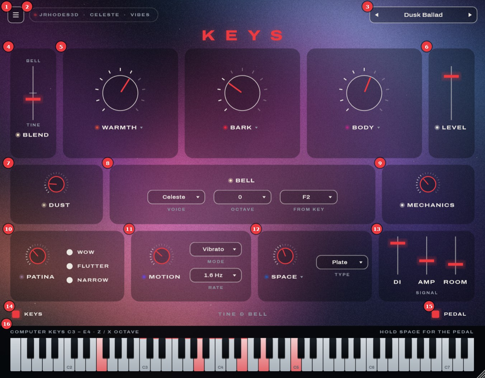
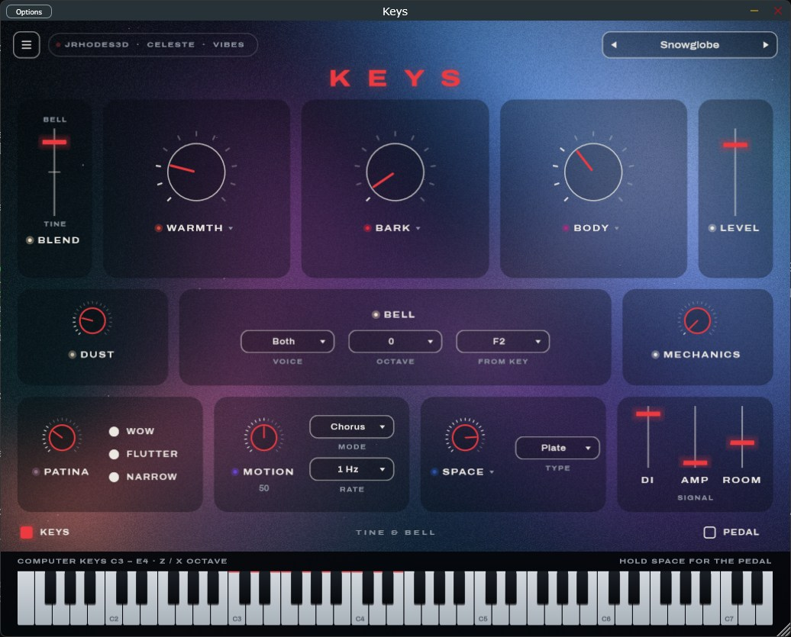

# Keys — user guide

What the current build does, how to play and shape it, and how to test your MIDI keyboard with
it. All screenshots are of the real app unless the caption says otherwise.

## Start it

Run `build\vs2026\Keys_artefacts\Release\Standalone\Keys.exe` (build steps are in the
[README](../README.md)). The library chip **(2)** says `LOADING TINES...` for about a second, then
`JRHODES3D · CELESTE · VIBES` (or `DEMO TINES · ...` without the Rhodes samples). Notes are silent
until then.

## The window

| # | Part | What it does |
|---|---|---|
| 1 | ☰ Menu | Tune, Touch, the still background, a MIDI monitor, the library and credits (see [the menu](#the-menu)). |
| 2 | Library chip | Which sounds are loaded. *Demo tines* means the modeled tines are playing (no Rhodes samples, or the menu says *Modeled*); *Modeled bell* instead of *Celeste* means the bell samples are missing. The fetch scripts are in `scripts\`. The red light flashes on every MIDI message. |
| 3 | Presets | ◀ ▶ step through the presets; click the name for the list, *Save preset…* and the presets folder. |
| 4 | Blend | Tines at the bottom, bell at the top, both at full in the middle (it snaps there). |
| 5 | Warmth, Bark, Body | The three big colour knobs. Each ▾ opens its fine controls. |
| 6 | Level | Output level, −∞ to +6 dB. |
| 7 | Dust | Tape hiss and vinyl crackle. It plays even between notes, like a real old tape. |
| 8 | Bell | **Voice**: Celeste, Vibes, or Both (vibes below C4, celeste above). **Octave**: 0 or +1. **From key**: the lowest key the bell plays on; it fades in over the six keys below. |
| 9 | Mechanics | The instrument's own noises: keys landing, dampers falling, the pedal. |
| 10 | Patina | Worn tape. **Wow** (a slow pitch drift), **Flutter** (a fast one) and **Narrow** (the band closes in) switch its parts on and off. |
| 11 | Motion | **Vibrato** (a suitcase Rhodes' stereo swing), **Chorus**, or **Both**, at the **Rate** you pick. |
| 12 | Space | **Spring**, **Plate** or **Room** reverb. ▾ for pre-delay, decay and tone. |
| 13 | Signal | Three microphones on one instrument: the dry **DI**, a small **Amp**, and a **Room** mic. |
| 14 | Keys | Shows or hides the on-screen keys (the window grows or shrinks). |
| 15 | Pedal | The sustain pedal. It lights up when your keyboard's pedal is down; click it to latch the pedal. |
| 16 | Keyboard | 73 keys, E1–E7, like a Mk II. Lights up for incoming MIDI. Click to play: lower on a key is louder. |

### Using the controls

- **Knobs and faders**: drag up or down. Hold **Shift** for fine steps, **double-click** to reset,
  or use the scroll wheel. A tile glows in its control's colour while you move it.
- **Values** show under each control while the mouse is over its tile.
- Every control is a host parameter, so automation and MIDI mapping work in your DAW.
- The window can be resized from its bottom-right corner (60–160 %).

### The colour knobs

Every colour knob at 0 switches its stage off completely; the **Bare DI** preset turns them all
off, as a reference.

| Knob | Turning it up | ▾ Fine controls |
|---|---|---|
| Warmth | A preamp: gentle saturation, fuller lows, a softer top. | **Drive** (how hard it saturates), **Tilt** (how much top it takes away), **Character** (Tube: soft and even; Transistor: firmer). |
| Bark | The growl of a tine close to its pickup. It's per note: harder playing barks more. | **Velocity to bark**, **Tine ding** (the attack's bright "ding": below the middle softer, above brighter). |
| Body | Low-mid fullness. | **Resonance** (a lift around 330 Hz), **Double** (a second tine a few cents sharp, for a thicker sound), **Width** (low keys lean left, high keys right). |
| Patina | Worn tape: saturation, plus the three switches. | — |
| Motion | How deep the vibrato or chorus is. | — (Mode and Rate are on the tile) |
| Space | How much reverb. | **Pre-delay** (0–120 ms), **Decay** (0.5–4 s), **Tone** (dark to bright). |

### The light behind the controls

The picture follows the sound. Each colour knob owns a hue (Warmth coral, Bark crimson, Body
magenta, Patina mauve, Motion violet, Space deep blue) and turning it up brightens its light.
Motion makes the light drift and smear, Space adds haze and blur, Patina fades the blacks and
thickens the grain, Dust adds specks. Every note blooms as a glow above its key, and the bell adds
sparkles: gold for the celeste, ice blue for the vibraphone. **Still background** in the menu
almost stops the movement.

## Presets

| Preset | Character |
|---|---|
| Dusk Ballad | The starting sound: warm, a little bell |
| Sunday Tape | Worn cassette, room reverb |
| Glass Lullaby | Bell-forward, an octave up |
| Basement Soul | Barking, through the amp, spring reverb |
| Snowglobe | Mostly bell, chorus, a big plate |
| Late Bus | Vibes and tines, tape, wobbly |
| Bare DI | Every colour knob off: the reference |

Switching presets glides the knobs to their new places over half a second. Presets leave **Tune**,
**Touch** and **Level** alone: those are yours. *Save preset…* (in the preset list) stores the
current sound in `Documents\Keys\Presets`; your presets appear in the list under *Yours*. In a DAW,
the factory presets are also the plugin's programs.

## Play from the computer keyboard

In the standalone app, the computer keyboard plays notes:

- **A W S E D F T G Y H U J K O L P ;** play C3 up to E4 (the home row is the white keys, the row
  above the black ones). The keys they reach are marked with a red line on the keyboard **(16)**.
- **Z** and **X** shift the octave down and up.
- Hold **Space** for the sustain pedal.
- **Esc** closes an open menu or panel.

(In a DAW, the host usually keeps the computer keyboard for itself.)

## The menu

- **Library**: which tines play. **Sampled** is a real Rhodes: jRhodes3d, a 1977 Mark I
  (fetched by `scripts\fetch-rhodes-samples.ps1`; its samples are licensed CC BY-NC). **Modeled**
  is Keys' own physical model of a Mk II, which needs no samples. The choice is saved with your
  session. Your own Mk II recordings will appear here too.
- **Tune**: ±50 cents.
- **Touch**: the velocity response, from *even* (soft playing still sounds full) to *dynamic*.
- **Still background**: the light almost stops moving (for focus, or a slow computer).
- **MIDI**: the MIDI inputs the app found, the latest MIDI events, the pedal and how many voices
  are playing. This is the place to test a keyboard.
- **Credits** for the samples and the font.

## Test your MIDI keyboard

1. Plug the keyboard in (before or while the app runs). Within about 2 seconds the app switches
   it on: it switches on every MIDI input it finds.
2. Play a few notes. The red light in the library chip **(2)** flashes, the key lights up on
   **(16)**, and the light blooms above it. Open the menu **(1)**: the MIDI section shows
   `NOTE ON C4 vel 96 ch 1` and so on, and your keyboard's name.
3. Press the sustain pedal. **Pedal (15)** lights up, and the menu shows `CC 64 (sustain) 127`
   and `Pedal down`. Notes ring on after you let go of the keys until you lift the pedal.
4. Play soft and hard. If your hardest playing never sounds full, or soft notes vanish, move
   **Touch** in the menu.

**Something not working?**

- **The menu says `No MIDI input found`**: Windows doesn't report any MIDI device. Re-plug the
  keyboard, try another USB port or cable, and check it appears in Device Manager.
- **The keyboard is listed but nothing arrives**: another program may be holding it. On Windows a
  MIDI input is usually open in one program at a time, so close Ableton Live (or its MIDI
  preferences) and try again. You can also tick the input by hand: **Options** (top left of the
  window) → *Audio/MIDI Settings* → *Active MIDI inputs*.
- **No sound**: Options → *Audio/MIDI Settings* → pick your output device. Check that Level **(6)**
  isn't at −∞.
- **A quiet hiss when nothing plays**: that's Dust **(7)**. Turn it to 0 for silence.
- **Clicks or crackles, or a late response**: in the same dialog choose an ASIO or WASAPI device,
  with a buffer of 128–256 samples.

## The app compared with the Nocturne demo

The [Nocturne demo](mockup/nocturne.html) is the design the window is built from. The app now has
everything in it, with the real engine behind the controls.

*The Nocturne HTML demo. This is a design preview, not a screenshot of the app.*

| Feature | Nocturne demo | App |
|---|---|---|
| Sound | a small browser synth standing in | the real engine: modeled Mk II tines, celeste and vibraphone samples, and every colour stage below |
| Blend, Bell (voice, octave, from key), Level | yes | yes |
| Warmth, Bark, Body with ▾ fine controls | yes | yes (Bark works per note) |
| Patina (Wow, Flutter, Narrow), Motion (Mode, Rate), Space (Type, ▾) | yes | yes |
| Dust, Mechanics | yes | yes |
| DI / Amp / Room | yes | yes: Amp and Room are rendered from the modeled DI until a Mk II is sampled |
| Presets, gliding between them | yes | yes, plus saving your own |
| The moving light, glows and sparkles | yes | yes |
| Tune, Touch in the ☰ menu | yes | yes |
| MIDI monitor | no | yes, in the menu |
| Sampled tines | — | yes: jRhodes3d (a Mark I) now, your Mk II once it's recorded ([sampling plan](sampling-plan.md)) |
